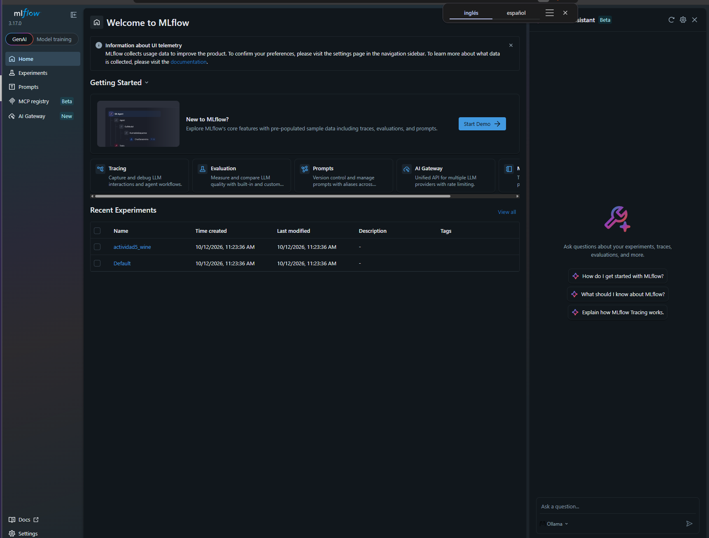
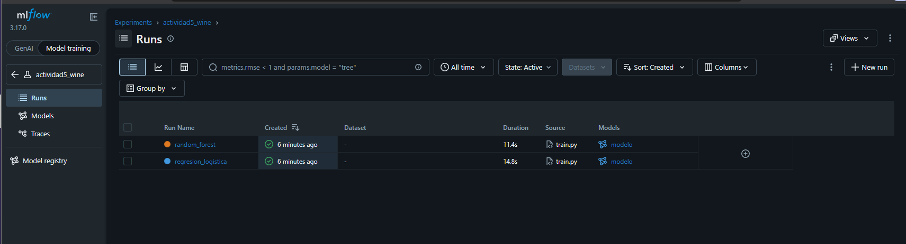
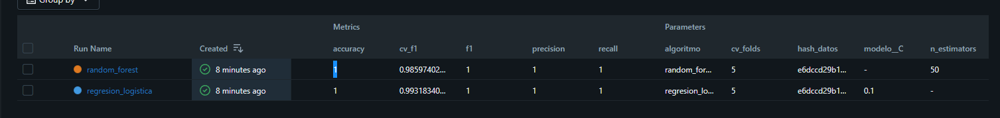
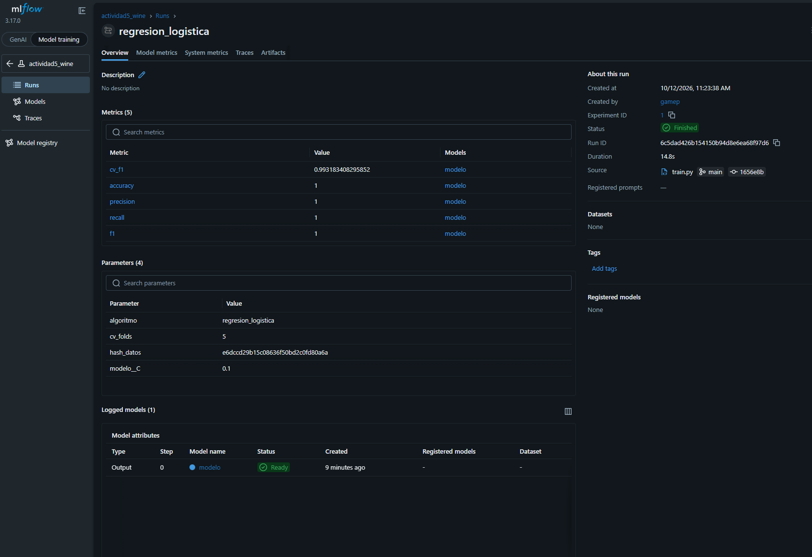

# Actividad 5: Entrenamiento y registro de experimentos con MLflow

## Objetivo
Preparar datos, entrenar dos algoritmos de clasificación, ajustar hiperparámetros
con validación cruzada y registrar los experimentos en MLflow.

## Dataset
Wine (scikit-learn): 178 muestras, 13 variables numéricas, 3 clases de vino.

## Estructura
- `datos/datos_ini.csv`: datos originales
- `datos/datos_limp.csv`: datos limpios (sin nulos ni duplicados)
- `fuentes/datos_prep.py`: funciones de carga, limpieza y división
- `fuentes/train.py`: entrenamiento y registro en MLflow
- `fuentes/entrena.ipynb`: notebook de Colab con entrenamiento y evaluación
- `evidencias/`: capturas de la interfaz de MLflow
- `CHANGELOG.md`: reporte final con resultados y conclusión

## Cómo reproducirlo
```bash
git clone https://github.com/Pulido325051/ACTIVIDAD-5.git
cd ACTIVIDAD-5
pip install mlflow scikit-learn pandas
python fuentes/train.py
python -m mlflow ui
```
Abrir http://127.0.0.1:5000 para ver los experimentos.

También se puede abrir `fuentes/entrena.ipynb` en Google Colab y ejecutar las celdas en orden.

## Decisiones
- Algoritmos: regresión logística (con escalado) y random forest.
- Validación: GridSearchCV con 5 folds, métrica f1 ponderada.
- Métricas finales en el conjunto de prueba (20%): accuracy, precision, recall y f1.
- División con `random_state=42` y estratificada para poder repetir resultados.
- Versionamiento de datos: dos archivos (originales y limpios) y el hash MD5
  de los datos limpios registrado en cada corrida de MLflow.

## Resultados
| Algoritmo | Mejores hiperparámetros | F1 (CV) |
|---|---|---|
| Regresión logística | C = 0.1 | 0.993 |
| Random forest | max_depth = 3, n_estimators = 50 | 0.986 |

En el conjunto de prueba ambos modelos obtuvieron 1.00 en todas las métricas.
El detalle y la conclusión están en `CHANGELOG.md`.

## Evidencias de MLflow
Se configuró MLflow con seguimiento local y se validó que cada corrida registre
parámetros, métricas y el modelo entrenado.

**Experimento `actividad5_wine` en MLflow**



**Corridas del experimento (una por algoritmo)**



**Comparación de métricas y parámetros registrados**



**Detalle de la corrida `regresion_logistica`**



**Artefactos registrados en la corrida**

